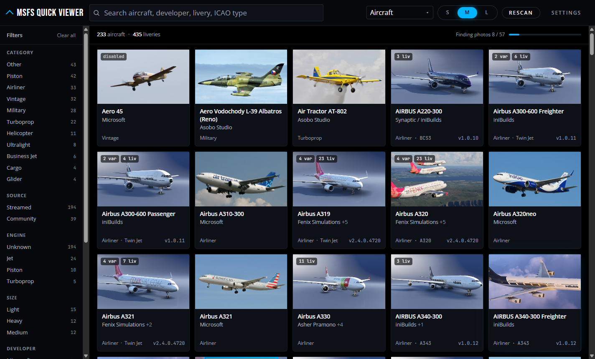
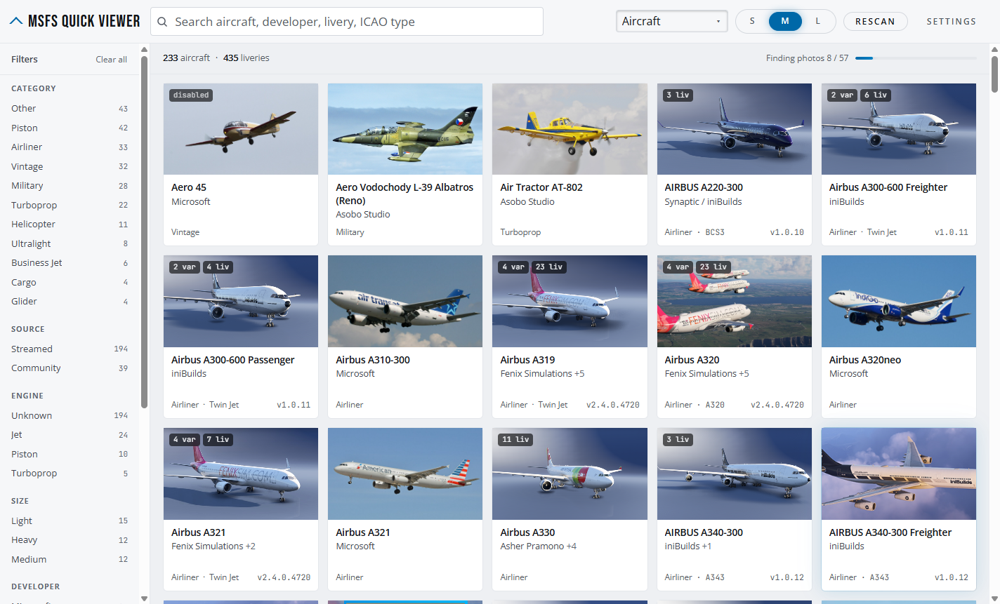

# MSFS Quick Viewer

A portable Windows app that shows every aircraft installed in Microsoft Flight
Simulator 2024 as a thumbnail grid, with categories, search and per-aircraft
livery galleries.



## Running it

**[Download the latest release](https://github.com/vishal111-sudo/msfs-quick-viewer/releases/latest)**
and double-click the `.exe`. No installer, no admin rights, nothing to
configure. It finds your sim on its own.

The first launch shows which install it found and asks whether to fetch photos
for aircraft that have none on disk, before it reads or downloads anything.
Every launch after that goes straight to your aircraft.

From a source checkout, the built executable sits in the project root as
`MSFS-Quick-Viewer-<version>-portable.exe`.

The executable is not code-signed, so Windows SmartScreen shows *"Windows
protected your PC"* and hides the run button behind **More info > Run anyway**.
Some antivirus tools also flag unsigned Electron apps. Signing needs a paid
certificate.

## What it does on your machine

* **Reads** your MSFS packages folder and `%APPDATA%\Microsoft Flight Simulator 2024\`.
  It never writes to either, so it cannot change your sim install.
* **Writes** only to `%APPDATA%\MSFS Quick Viewer\`, for settings and cached
  photos. Delete that folder to reset the app.
* **Network**: fetches aircraft photos from Wikipedia or Wikimedia Commons,
  once per aircraft, only where no thumbnail exists on disk. Set the photo
  source to **Off** in Settings and it makes no network requests at all. It
  sends nothing about you or your system.

## What it scans

Both editions are found automatically. Four locations are probed:

| | Steam | Microsoft Store / Game Pass |
|---|---|---|
| **MSFS 2024** | `%APPDATA%\Microsoft Flight Simulator 2024\` | `%LOCALAPPDATA%\Packages\Microsoft.Limitless_8wekyb3d8bbwe\LocalCache\` |
| **MSFS 2020** | `%APPDATA%\Microsoft Flight Simulator\` | `%LOCALAPPDATA%\Packages\Microsoft.FlightSimulator_8wekyb3d8bbwe\LocalCache\` |

Each holds a `UserCfg.opt` naming the real packages path, which is often on
another drive. Every install that resolves is scanned. If none resolve, the app
lists what it checked and offers a folder picker that accepts either your
Community folder or the folder above it.

Under each packages root it walks `Community`, `Community2024`, `Official*` and
`StreamedPackages`, reading `manifest.json` and the aircraft under
`SimObjects/Airplanes/`. Both the FS2024 layout (`common/config/aircraft.cfg`,
`presets/`, `liveries/`) and the FS2020 layout (`[FLTSIM.n]` blocks,
`texture.<suffix>/`) are handled.

**Only flyable aircraft are listed.** Anything flagged `isAirTraffic = 1` or
`isUserSelectable = 0` is dropped. Without that filter a typical install reports
about 2,700 "aircraft" instead of about 170.

## One card per aircraft

The card is the aircraft, not the package. Livery packs merge into the aircraft
they decorate, and clicking a card lists every installed livery.

Add-ons that ship several aircraft in one folder are split by what actually
differs:

* **Equipment is a variant.** A 777-200ER with GE, PW or RR engines is one card
  with a variant count. Same for winglet and cabin options.
* **A role is a different aircraft.** MD-11 and MD-11F are two cards, as are
  the A300-600 Freighter and Passenger.
* **A different model is a different aircraft.** A319, A320, A321.

Identity comes from the ICAO type designator where the author declares one, and
from the model name with equipment words stripped where they do not. A preset
only earns its own card if it names a model, meaning it contains a digit.
Otherwise it is a fitting, not a model (SimWorks' Kodiak ships 24 such presets).

Names are cleaned for display, localisation tokens are resolved against the
package `.locPak`, and the default sort groups the same real aircraft together
whatever the source, so the stock 737 MAX sits next to iFly's. Aircraft
disabled in the Content Manager are badged as such.

## Artwork

Priority is always: a thumbnail you set yourself, then the add-on's own files on
disk, then a fetched photo. Nothing is downloaded for an aircraft that already
has a picture.

Stock aircraft in `StreamedPackages` are encrypted `.fsarchive` blobs with no
thumbnail on disk, so two things fill the gap: a catalog mapping stock slugs to
real aircraft names, and a photo source chosen in Settings.

* **Wikipedia article photo** (default). Curated, one per type.
* **Wikimedia Commons.** Larger, covers aircraft with no article. Shows the
  photographer credit.
* **Off.** No network requests.

Photos are fetched once in the background after a scan and cached to disk, so
every later launch is offline and instant. The header reports overall progress.

Where a match is wrong, the detail panel offers **Find a different photo**,
**Paste image** (Ctrl+V) and **Set thumbnail...**. A thumbnail you set yourself
is never overwritten.

## Look

The interface takes its look from flightsimulator.com so it feels at home next
to the sim: black, white type, one sky blue, Bebas Neue for headings and Open
Sans for everything else. Dark, light, or match Windows, chosen in Settings.
Light mode uses a darker blue, because the site's blue measures 2.3:1 on white.



The look only: no Microsoft or Flight Simulator logos, wordmarks or artwork
are used.

**MSFS Quick Viewer is an unofficial, independent tool. It is not affiliated
with, endorsed by, or connected to Microsoft or Asobo Studio. Microsoft Flight
Simulator is a trademark of Microsoft Corporation.**

## Accuracy

Everything that reads what the sim or the author declared (`manifest.json`,
`aircraft.cfg`, `livery.cfg`, `.locPak`, `Content.xml`, ICAO designators) works
for anyone.

Developer prefixes are learned at scan time rather than listed, because a list
is only ever right for the library it was written against and cannot know
about a studio that ships its first aircraft tomorrow. Four rules, strongest
first: the `<vendor>-aircraft-<model>` folder convention; a folder prefix that
echoes the package's declared `creator`, which catches abbreviations like
`mscarenado-` for Carenado; a prefix one creator uses across several packages,
which catches abbreviations that resemble nothing in the studio's name; and
finally, dropping the leading segment of an airframe folder outright, which
needs no vocabulary at all and is what handles a studio tag the package folder
never mentions. Only sim-internal forms are hard-coded, since those have no
manifest to read.

Three things are curated word lists tuned against one library, and will have
gaps: equipment vs role words, category keywords, and the stock aircraft
catalog. A gap costs a worse name or a broader category, never a crash.

**Settings > Scan diagnostics** reports where the app had to guess for your
install: tags learned, stock aircraft missing from the catalog, aircraft it
could not categorise. That output is the useful thing to include in a bug
report.

## Categories

Airliner, Business Jet, Cargo, Turboprop, Piston, Glider, Helicopter, Military,
Vintage, Ultralight, Other. Derived from `ui_typerole`, `Category`,
`icao_engine_type`, `icao_WTC` and the name. Sidebar facets for engine, size,
source and developer cut across the same set.

## Building

```bash
npm install
npm start          # build the UI, then run from source
npm test           # scanner and UI-logic tests, no sim needed
npm run dist       # build the portable exe into the project root
```

The UI is React on [ARC UI](https://arcui.dev)'s components, built by Vite from
`ui/` into `src/renderer/`, which is generated and not committed. React, ARC
and the fonts are bundled into the build, so the shipped app has no loose
`node_modules`. The theme is a set of overrides of ARC's design tokens in
`ui/theme.css`; every component reads them, so that one file decides how the
app looks.

Shipping a version:

```bash
npm version patch
npm run dist
gh release create v$(node -p "require('./package.json').version") MSFS-Quick-Viewer-*-portable.exe --generate-notes
```

The executable is not committed. A 96 MB binary per build would live in git
history forever, so it belongs on the release page.

Developer probes run against your real install. The ones that open the app
use a temporary copy of your profile, so they never change your settings.
Build the UI first (`npm run build:ui`) for the `electron` ones.

```bash
node scripts/probe-scan.js                # full scan: counts, categories, developers
node scripts/probe.js <packageName>       # detail for one package
npx electron scripts/smoke.js             # boot, screenshot, report console errors
npx electron scripts/probe-first-run.js   # a new user's first launch, on a timeline
npx electron scripts/inspect.js           # contrast in both themes, fails below WCAG AA
npx electron scripts/screenshots.js       # regenerate the README screenshots
```

Every screenshot these write is redacted first: drive letters become `C:` and
any Windows username becomes `Pilot`.

## Layout

```
src/main/
  main.js               window, IPC, the msfsart:// image protocol
  preload.js            the only surface the renderer can reach
  scanner.js            walks every install, merges packages into aircraft
  roots.js              locates sim installs from UserCfg.opt
  contentxml.js         enabled/disabled state
  art.js                photo lookup, disk cache, user overrides
  store.js              atomic JSON settings
  parsers/              cfg, locpak, package, streamed, taxonomy
  data/aircraft-catalog.js
ui/
  components/           App, TopBar, Sidebar, AircraftCard, DetailDrawer,
                        SettingsDrawer, Welcome, ScanSplash, ...
  lib/filters.mjs       filtering, facet counts, sorting (tested)
  lib/format.mjs        labels and estimates (tested)
  lib/art.js            photo store and background sweep
  theme.css             the look, as ARC token overrides
  app.css               layout
src/renderer/           built from ui/ (generated)
test/                   scanner fixtures and UI-logic tests
```

The renderer runs with `contextIsolation` on, `nodeIntegration` off, and a CSP
that allows no remote content and no script but the app's own. One relaxation:
`style-src-attr 'unsafe-inline'`, because ARC's components set inline `style`
attributes (a progress bar's width, for one) and render broken without it.
Inline `<style>` blocks stay blocked. Images are served through a custom
`msfsart://` scheme that only reads from the scanned package roots and the
app's own cache directory. Fetched images are stored locally, never hotlinked.
